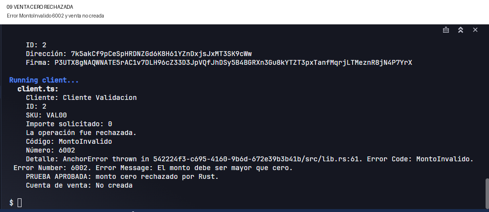
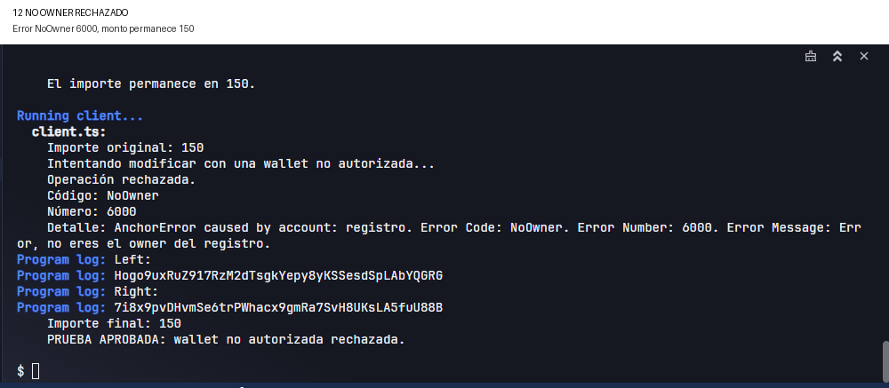
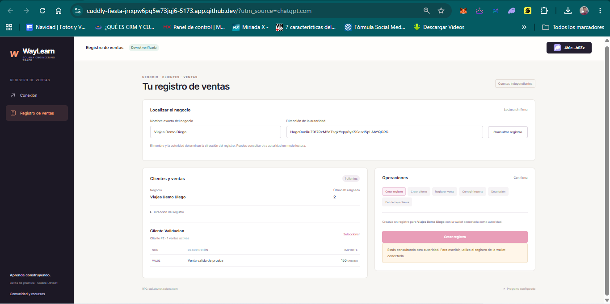

# Evidencias de pruebas en Solana Devnet

Para el proyecto de certificación Advanced tomé como base el ejercicio de registro de ventas de WayLearn. Lo adapté para trabajar con mi programa en Devnet e incorporé una validación en Rust que impide crear ventas con importe cero o cambiar una venta existente a cero.

El **22 de noviembre de 2026** probé el registro de un negocio, el alta de clientes, ventas, correcciones de importe, devoluciones y bajas. También comprobé que el programa rechazara acciones no permitidas. Las capturas corresponden a esas pruebas, no a datos de clientes reales.

## Capturas

| Archivo | Qué comprobé |
| --- | --- |
| [01_registro_creado.png](./01_registro_creado.png) | Creación del negocio Viajes Demo Diego |
| [02_cliente_1_creado.png](./02_cliente_1_creado.png) | Alta del primer cliente |
| [03_venta_VJ001_150.png](./03_venta_VJ001_150.png) | Registro de una venta por 150 |
| [04_cambio_VJ001_200.png](./04_cambio_VJ001_200.png) | Corrección del importe de 150 a 200 |
| [05_baja_rechazada_con_venta.png](./05_baja_rechazada_con_venta.png) | Rechazo de baja con una venta activa (6003) |
| [06_devolucion_confirmada.png](./06_devolucion_confirmada.png) | Devolución y cierre de la cuenta de la venta |
| [07_baja_cliente_confirmada.png](./07_baja_cliente_confirmada.png) | Baja del cliente después de la devolución |
| [08_cliente_2_creado.png](./08_cliente_2_creado.png) | Segundo cliente para las pruebas de validación |
| [09_venta_cero_rechazada.png](./09_venta_cero_rechazada.png) | Rechazo de venta por importe cero (6002) |
| [10_venta_valida_VAL01.png](./10_venta_valida_VAL01.png) | Venta válida para comprobar modificaciones |
| [11_cambio_cero_rechazado.png](./11_cambio_cero_rechazado.png) | Rechazo del cambio de importe a cero (6002) |
| [12_no_owner_rechazado.png](./12_no_owner_rechazado.png) | Rechazo de una wallet sin autorización (6000) |
| [13_frontend_consulta_devnet.png](./13_frontend_consulta_devnet.png) | Lectura en la aplicación de los datos registrados en Devnet |

## Qué quedó funcionando

En Solana Playground pude ejecutar las operaciones de escritura y comprobar sus resultados. En la aplicación web consulté el negocio **Viajes Demo Diego**, el cliente **Cliente Validacion** (ID 2) y su venta **VAL01** por 150 unidades.

La firma de transacciones desde la URL temporal de Codespaces quedó sin verificar: Phantom bloqueó esa solicitud. No desactivé la advertencia. Por eso las operaciones de escritura que documenté se ejecutaron desde Playground.

El código utilizado está en [programa/src/lib.rs](../programa/src/lib.rs), y los resultados de cada prueba están explicados en [docs/EVIDENCIAS-DEVNET.md](../docs/EVIDENCIAS-DEVNET.md). El programa desplegado puede consultarse en [Solana Explorer](https://explorer.solana.com/address/H5MRzA9kNFVDL7Fwdmaf5iHyXauhZBYgTqisHufYWuTe?cluster=devnet).

## Tres pruebas que considero más relevantes

**Validación del contrato al registrar ventas:** intento de venta por importe cero, rechazado con `MontoInvalido` (6002).

**Control de permisos:** el programa rechazó una operación enviada por una wallet distinta a la propietaria (`NoOwner`, 6000).

**Consulta desde la aplicación:** el frontend mostró el negocio, el cliente y la venta registrados en Devnet.

Las 13 capturas están cargadas en esta carpeta y pueden abrirse desde la tabla anterior.
